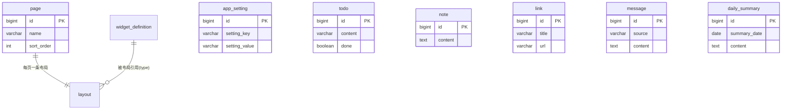

# 数据设计

> 覆盖 Nexus 的数据库选型、表结构、ER 关系与迁移策略。

---

## 一、数据库选型

| 环境 | 选型 | 说明 |
|---|---|---|
| 开发/测试 | H2（内存/文件） | 零部署即可跑，Flyway 自动建表 |
| 生产 | PostgreSQL | 为 V1 的 pgvector 向量检索铺路，`h2 → pg` 通过 Flyway + JPA 方言切换 |

> 原则：开发用 H2 让项目"clone 即跑"，生产用 PostgreSQL 平滑升级，中间靠 Flyway 版本化迁移，避免手改库。

---

## 二、表结构

### 1. widget_definition（组件目录）

组件市场的雏形：组件元信息与前端注册表一一对应。

| 字段 | 类型 | 约束 | 说明 |
|---|---|---|---|
| id | BIGINT | PK, IDENTITY | 主键 |
| type | VARCHAR(64) | NOT NULL, UNIQUE | 组件类型标识（前端注册表 key） |
| name | VARCHAR(128) | NOT NULL | 组件显示名 |
| description | VARCHAR(512) | | 组件描述 |
| default_w | INT | NOT NULL, DEFAULT 4 | 默认宽度（栅格单位） |
| default_h | INT | NOT NULL, DEFAULT 4 | 默认高度 |
| icon | VARCHAR(64) | | 图标标识 |

### 2. layout（页面布局）

每个页面一条记录（page_id 唯一），布局项以 JSON 存储。

| 字段 | 类型 | 约束 | 说明 |
|---|---|---|---|
| id | BIGINT | PK, IDENTITY | 主键 |
| page_id | BIGINT | NOT NULL, UNIQUE | 关联 page.id |
| items_json | TEXT | NOT NULL | 布局项 JSON 数组 |
| updated_at | TIMESTAMP | NOT NULL | 更新时间 |

`items_json` 结构：`[ { "widgetType": "clock", "x": 0, "y": 0, "w": 4, "h": 2 }, ... ]`

### 3. todo（待办事项）

| 字段 | 类型 | 约束 | 说明 |
|---|---|---|---|
| id | BIGINT | PK, IDENTITY | 主键 |
| content | VARCHAR(512) | NOT NULL | 待办内容 |
| done | BOOLEAN | NOT NULL, DEFAULT FALSE | 是否完成 |
| due_date | DATE | NULL | 到期日；NULL 表示没有期限，不参与提醒与排序（V11 新增） |
| created_at | TIMESTAMP | NOT NULL | 创建时间 |

---

## 三、规划中表结构

### 4. note（便签，⏳ Phase 2）

| 字段 | 类型 | 约束 | 说明 |
|---|---|---|---|
| id | BIGINT | PK, IDENTITY | 主键 |
| content | TEXT | NOT NULL | 便签内容 |
| created_at | TIMESTAMP | NOT NULL | 创建时间 |
| updated_at | TIMESTAMP | NOT NULL | 更新时间 |

### 5. link（快捷链接，⏳ Phase 2）

| 字段 | 类型 | 约束 | 说明 |
|---|---|---|---|
| id | BIGINT | PK, IDENTITY | 主键 |
| title | VARCHAR(128) | NOT NULL | 链接标题 |
| url | VARCHAR(512) | NOT NULL | 链接地址 |
| sort_order | INT | NOT NULL, DEFAULT 0 | 排序（越小越靠前） |
| created_at | TIMESTAMP | NOT NULL | 创建时间 |

### 6. message（消息，📋 Phase 3）

统一消息模型，承载来自各第三方 Adapter 的消息。

| 字段 | 类型 | 约束 | 说明 |
|---|---|---|---|
| id | BIGINT | PK, IDENTITY | 主键 |
| source | VARCHAR(32) | NOT NULL | 来源（feishu/email/rss/...） |
| channel | VARCHAR(64) | | 渠道（群/私聊/...） |
| sender | VARCHAR(128) | | 发送者 |
| content | TEXT | NOT NULL | 消息内容 |
| received_at | TIMESTAMP | NOT NULL | 接收时间 |
| processed | BOOLEAN | NOT NULL, DEFAULT FALSE | 是否已处理（供 Agent 消化） |

### 7. daily_summary（每日总结，✅ Phase 4）

| 字段 | 类型 | 约束 | 说明 |
|---|---|---|---|
| id | BIGINT | PK, IDENTITY | 主键 |
| summary_date | DATE | NOT NULL, UNIQUE | 总结对应日期（一天一份） |
| content | TEXT | NOT NULL | 总结内容（Markdown） |
| message_count | INT | NOT NULL, DEFAULT 0 | 当天消息数 |
| todo_count | INT | NOT NULL, DEFAULT 0 | 当天待办数 |
| note_count | INT | NOT NULL, DEFAULT 0 | 当天便签数 |
| llm_mode | VARCHAR(32) | | enabled=真实 LLM / rule-based=规则降级 |
| created_at | TIMESTAMP | NOT NULL | 生成时间 |

### 8. subscription（订阅源，✅ Phase 5）

| 字段 | 类型 | 约束 | 说明 |
|---|---|---|---|
| id | BIGINT | PK, IDENTITY | 主键 |
| type | VARCHAR(16) | NOT NULL | 订阅类型（rss / bilibili） |
| name | VARCHAR(128) | NOT NULL | 订阅名 |
| url | VARCHAR(512) | NOT NULL | rss 填 feed 地址；bilibili 填 UP 主 uid |
| enabled | BOOLEAN | NOT NULL, DEFAULT TRUE | 是否启用 |
| last_fetched_at | TIMESTAMP | | 上次抓取时间 |
| created_at | TIMESTAMP | NOT NULL | 创建时间 |

### 9. feed_item（已抓取条目，✅ Phase 5）

去重用：同一订阅源的同一外部 ID 只入流一次。

| 字段 | 类型 | 约束 | 说明 |
|---|---|---|---|
| id | BIGINT | PK, IDENTITY | 主键 |
| subscription_id | BIGINT | NOT NULL | 所属订阅 |
| external_id | VARCHAR(512) | NOT NULL | 条目唯一标识（RSS guid / B站 dynamic_id） |
| created_at | TIMESTAMP | NOT NULL | 入库时间 |

> 唯一约束：`UNIQUE(subscription_id, external_id)`。

### 10. app_setting（应用设置，✅ Phase 6）

key-value 结构，当前存 LLM 配置（`llm.apiKey` / `llm.baseUrl` / `llm.model`）。

| 字段 | 类型 | 约束 | 说明 |
|---|---|---|---|
| id | BIGINT | PK, IDENTITY | 主键 |
| setting_key | VARCHAR(64) | NOT NULL, UNIQUE | 设置项 key |
| setting_value | VARCHAR(1024) | | 设置值 |
| updated_at | TIMESTAMP | NOT NULL | 更新时间 |

### 11. page（页面，✅ Phase 6）

多页面工作台：每个页面独立 DIY 组件布局。

| 字段 | 类型 | 约束 | 说明 |
|---|---|---|---|
| id | BIGINT | PK, IDENTITY | 主键 |
| name | VARCHAR(128) | NOT NULL | 页面名 |
| sort_order | INT | NOT NULL, DEFAULT 0 | 排序 |
| created_at | TIMESTAMP | NOT NULL | 创建时间 |

> 关系：page 1——1 layout（layout.page_id 唯一），删除页面级联删除布局。

### 12. job_application（投递记录，✅ Phase 13）

| 字段 | 类型 | 约束 | 说明 |
|---|---|---|---|
| id | BIGINT | PK, IDENTITY | 主键 |
| company | VARCHAR(128) | NOT NULL | 公司名 |
| job_title | VARCHAR(128) | NOT NULL, DEFAULT '' | 岗位名；避开 SQL 保留字 `position` 所以叫 job_title |
| category | VARCHAR(24) | NOT NULL, DEFAULT 'autumn' | autumn / spring / intern / social / soe / other |
| stage | VARCHAR(24) | NOT NULL, DEFAULT 'applied' | 线性阶段，`rejected` 是旁路终态 |
| url | VARCHAR(1024) | NULL | 招聘页 / 公告链接 |
| next_action | VARCHAR(256) | NULL | 下一步要做什么 |
| next_at | DATE | NULL | 下一步日期，只到天 |
| starred | BOOLEAN | NOT NULL, DEFAULT FALSE | 重点关注（置顶） |
| note | TEXT | NULL | 复盘笔记（Markdown） |
| created_at / updated_at | TIMESTAMP | NOT NULL | 时间戳 |

> 关系：job_application 1——N job_event（时间线，级联删除）。

### 13. job_posting（校招岗位，✅ Phase 15）

外部渠道抓来的在招岗位，与投递记录分开：这张表是「外面有什么」，job_application 是「我投了什么」。

| 字段 | 类型 | 约束 | 说明 |
|---|---|---|---|
| id | BIGINT | PK, IDENTITY | 主键 |
| source | VARCHAR(32) | NOT NULL, DEFAULT 'qiuzhaowang' | 来源；`manual` 表示手动添加 |
| source_id | VARCHAR(128) | NOT NULL | 来源站内 id，与 source 组成唯一键 |
| company | VARCHAR(128) | NOT NULL | 公司名 |
| title | VARCHAR(256) | NOT NULL, DEFAULT '' | 招聘公告标题 |
| positions | VARCHAR(2048) | NULL | 岗位方向明细（一条公告常含多个方向） |
| city | VARCHAR(256) | NULL | 工作地点（可能是「上海 · 南京 · 深圳」） |
| cohort | VARCHAR(32) | NULL | 届别，如 2027届 |
| batch | VARCHAR(32) | NULL | 批次，如 27秋招 / 春招专场 |
| company_type | VARCHAR(32) | NULL | 企业性质：国企 / 民企 / 事业单位 |
| category | VARCHAR(24) | NOT NULL | 由批次/性质推断的投递类型 |
| detail_url | VARCHAR(512) | NULL | 来源站详情页 |
| announce_url | VARCHAR(1024) | NULL | 招聘方官方公告（真正的投递入口） |
| deadline_text | VARCHAR(64) | NULL | 截止文案，站上多为「尽快投递」 |
| published_at | DATE | NULL | 公告日期（只用天，站点本身只到天） |
| starred / ignored | BOOLEAN | NOT NULL, DEFAULT FALSE | 收藏 / 忽略 |
| job_id | BIGINT | NULL | 加入求职追踪后回填的投递 id；投递被删时断开 |
| fetched_at / created_at | TIMESTAMP | NOT NULL | 抓取时间 / 首次入库时间（NEW 标用前者之外的 created_at） |

> 约束：`UNIQUE (source, source_id)` —— 抓取每天跑，靠来源 id 去重，而不是靠「公司 + 岗位名」这种会变的组合。

---

### 14. mail_message（邮箱消息，✅ Phase 16）

从邮箱（IMAP）抓下来的邮件副本。**只读表**：本系统从不回写邮箱，所有状态变更只影响这张表。

| 字段 | 类型 | 约束 | 说明 |
|---|---|---|---|
| id | BIGINT | PK, IDENTITY | 主键 |
| account | VARCHAR(128) | NOT NULL | 收件邮箱地址；去重键由它与 imap_uid 组成，留出多账号余地 |
| imap_uid | BIGINT | NOT NULL | IMAP UID，同账号内唯一且稳定，增量抓取全靠它判重 |
| message_id | VARCHAR(255) | NULL | 邮件头 Message-ID；可能为空（部分营销系统不发） |
| sender_addr / sender_name | VARCHAR(255) / VARCHAR(128) | NOT NULL / NULL | 发件人地址与昵称（已解 encoded-word） |
| subject | VARCHAR(512) | NOT NULL | 主题 |
| snippet | VARCHAR(1000) | NULL | 正文前 200 字，列表页用，避免为预览查 TEXT |
| body | TEXT | NULL | 纯文本正文（去 HTML 标签、截断 2 万字），详情与 LLM 共用 |
| sent_at / received_at | TIMESTAMP | NULL / NOT NULL | 邮件发送时间 / 收信时间（缺前者时后者兜底） |
| important_score | INT | NOT NULL, DEFAULT 0 | 规则 + LLM 综合分 0–100 |
| important_level | VARCHAR(16) | NOT NULL, DEFAULT 'low' | `high`（自动建待办）/ `medium` / `low` |
| score_reason | VARCHAR(512) | NULL | 打分理由，直接展示「为什么重要」 |
| verdict_by | VARCHAR(16) | NOT NULL, DEFAULT 'rule' | `rule` / `llm` |
| has_attachment / read_flag | BOOLEAN | NOT NULL, DEFAULT FALSE | 是否含附件 / 抓取那一刻在邮箱里是否已读 |
| todo_id | BIGINT | NULL | 自动或手动生成的待办 id；待办被删后悬挂，读取时按存在性兜底 |
| ignored | BOOLEAN | NOT NULL, DEFAULT FALSE | 用户手动忽略 |
| created_at | TIMESTAMP | NOT NULL | 入库时间 |

> 约束：`UNIQUE (account, imap_uid)` —— IMAP 只能按 UID 判断「这封收过了」。用 message_id 不行，很多营销邮件根本没有 Message-ID。
> 列名用 `imap_uid` 而不是 `uid`：H2 有同名函数，避开方言差异。

配置项存在 `app_setting`（前缀 `mail.`）：`address`、`authCode`、`imapHost/Port/Ssl`、`folder`、`enabled`、`autoTodo`、`llmJudge`、`ignoreSenders`、`extraKeywords`、`fetchLimit`、`lastSyncAt`、`lastError`。

---

## 四、ER 关系

> 说明：当前布局通过 `widgetType` 字符串关联组件定义，不强依赖外键，保持组件可插拔。消息 → 每日总结的"消化"关系在 Phase 4 由 Agent 编排建立，非数据库外键。
> 这张 ER 图只画最早期的核心表；后续业务表（`job_application` / `job_posting` / `mail_message` 等）以上文明细为准。

---

## 五、迁移策略（Flyway）

| 约定 | 说明 |
|---|---|
| 命名 | `V{n}__{描述}.sql`，按顺序递增，禁止修改已应用的迁移 |
| 位置 | `backend/src/main/resources/db/migration/` |
| 已应用版本 | V1（widget_definition/layout/todo）、V2（note/link）、V3（message）、V4（daily_summary）、V5（subscription/feed_item）、V6（app_setting/page + layout 重建）、V7（algorithm_question）、V8（chat_widget）、V9（chat_memory）、V10（job_application/job_event）、V11（todo.due_date）、V12（job_posting）、V13（mail_message） |

> 规则：任何表结构变更都以**新增迁移文件**进行，绝不手改已发布迁移；本地数据如需重置，删除 H2 文件后重启即可自动重建。
