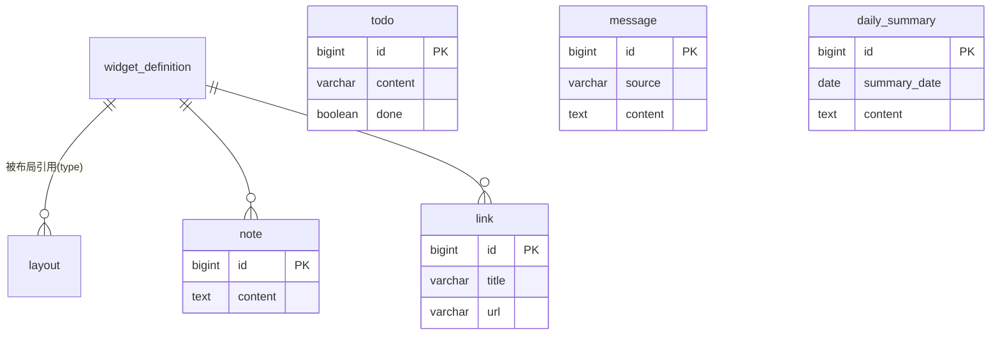

# 数据设计

> 覆盖 Nexus 的数据库选型、表结构、ER 关系与迁移策略。

---

## 一、数据库选型

| 环境 | 选型 | 说明 |
|---|---|---|
| 开发/测试 | H2（内存/文件） | 零部署即可跑，Flyway 自动建表 |
| 生产 | PostgreSQL | 为 V1 的 pgvector 向量检索铺路，`h2 → pg` 通过 Flyway + JPA 方言切换 |

> 原则：开发用 H2 让项目"clone 即跑"，生产用 PostgreSQL 平滑升级，中间靠 Flyway 版本化迁移，避免手改库。

---

## 二、表结构

### 1. widget_definition（组件目录）

组件市场的雏形：组件元信息与前端注册表一一对应。

| 字段 | 类型 | 约束 | 说明 |
|---|---|---|---|
| id | BIGINT | PK, IDENTITY | 主键 |
| type | VARCHAR(64) | NOT NULL, UNIQUE | 组件类型标识（前端注册表 key） |
| name | VARCHAR(128) | NOT NULL | 组件显示名 |
| description | VARCHAR(512) | | 组件描述 |
| default_w | INT | NOT NULL, DEFAULT 4 | 默认宽度（栅格单位） |
| default_h | INT | NOT NULL, DEFAULT 4 | 默认高度 |
| icon | VARCHAR(64) | | 图标标识 |

### 2. layout（工作台布局）

单用户场景，固定一行（id = 1），布局项以 JSON 存储。

| 字段 | 类型 | 约束 | 说明 |
|---|---|---|---|
| id | BIGINT | PK | 固定为 1 |
| items_json | TEXT | NOT NULL | 布局项 JSON 数组 |
| updated_at | TIMESTAMP | NOT NULL | 更新时间 |

`items_json` 结构：`[ { "widgetType": "clock", "x": 0, "y": 0, "w": 4, "h": 2 }, ... ]`

### 3. todo（待办事项）

| 字段 | 类型 | 约束 | 说明 |
|---|---|---|---|
| id | BIGINT | PK, IDENTITY | 主键 |
| content | VARCHAR(512) | NOT NULL | 待办内容 |
| done | BOOLEAN | NOT NULL, DEFAULT FALSE | 是否完成 |
| created_at | TIMESTAMP | NOT NULL | 创建时间 |

---

## 三、规划中表结构

### 4. note（便签，⏳ Phase 2）

| 字段 | 类型 | 约束 | 说明 |
|---|---|---|---|
| id | BIGINT | PK, IDENTITY | 主键 |
| content | TEXT | NOT NULL | 便签内容 |
| created_at | TIMESTAMP | NOT NULL | 创建时间 |
| updated_at | TIMESTAMP | NOT NULL | 更新时间 |

### 5. link（快捷链接，⏳ Phase 2）

| 字段 | 类型 | 约束 | 说明 |
|---|---|---|---|
| id | BIGINT | PK, IDENTITY | 主键 |
| title | VARCHAR(128) | NOT NULL | 链接标题 |
| url | VARCHAR(512) | NOT NULL | 链接地址 |
| sort_order | INT | NOT NULL, DEFAULT 0 | 排序（越小越靠前） |
| created_at | TIMESTAMP | NOT NULL | 创建时间 |

### 6. message（消息，📋 Phase 3）

统一消息模型，承载来自各第三方 Adapter 的消息。

| 字段 | 类型 | 约束 | 说明 |
|---|---|---|---|
| id | BIGINT | PK, IDENTITY | 主键 |
| source | VARCHAR(32) | NOT NULL | 来源（feishu/email/rss/...） |
| channel | VARCHAR(64) | | 渠道（群/私聊/...） |
| sender | VARCHAR(128) | | 发送者 |
| content | TEXT | NOT NULL | 消息内容 |
| received_at | TIMESTAMP | NOT NULL | 接收时间 |
| processed | BOOLEAN | NOT NULL, DEFAULT FALSE | 是否已处理（供 Agent 消化） |

### 7. daily_summary（每日总结，✅ Phase 4）

| 字段 | 类型 | 约束 | 说明 |
|---|---|---|---|
| id | BIGINT | PK, IDENTITY | 主键 |
| summary_date | DATE | NOT NULL, UNIQUE | 总结对应日期（一天一份） |
| content | TEXT | NOT NULL | 总结内容（Markdown） |
| message_count | INT | NOT NULL, DEFAULT 0 | 当天消息数 |
| todo_count | INT | NOT NULL, DEFAULT 0 | 当天待办数 |
| note_count | INT | NOT NULL, DEFAULT 0 | 当天便签数 |
| llm_mode | VARCHAR(32) | | enabled=真实 LLM / rule-based=规则降级 |
| created_at | TIMESTAMP | NOT NULL | 生成时间 |

---

## 四、ER 关系

> 说明：当前布局通过 `widgetType` 字符串关联组件定义，不强依赖外键，保持组件可插拔。消息 → 每日总结的"消化"关系在 Phase 4 由 Agent 编排建立，非数据库外键。

---

## 五、迁移策略（Flyway）

| 约定 | 说明 |
|---|---|
| 命名 | `V{n}__{描述}.sql`，按顺序递增，禁止修改已应用的迁移 |
| 位置 | `backend/src/main/resources/db/migration/` |
| 已应用版本 | V1（widget_definition/layout/todo）、V2（note/link）、V3（message）、V4（daily_summary） |

> 规则：任何表结构变更都以**新增迁移文件**进行，绝不手改已发布迁移；本地数据如需重置，删除 H2 文件后重启即可自动重建。
