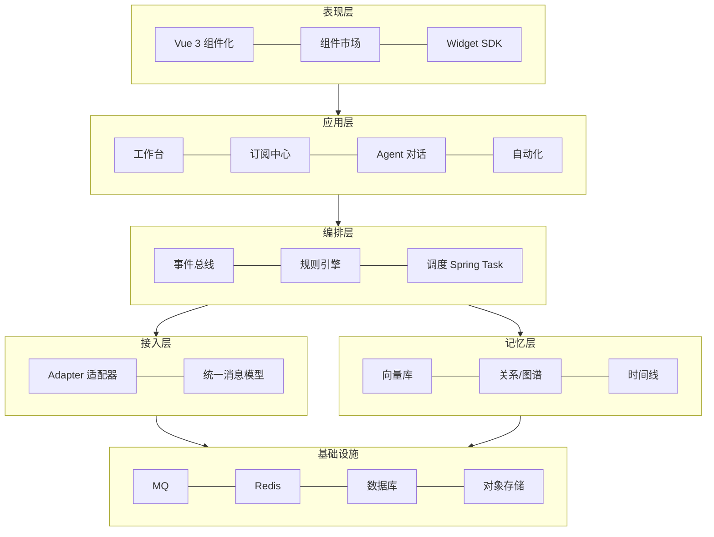
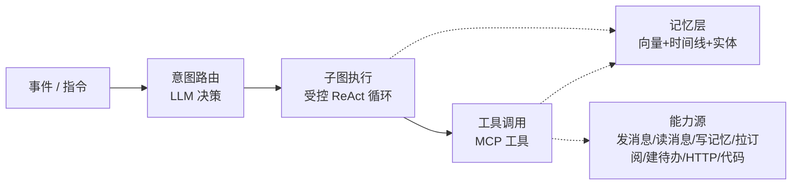

# 中枢 Nexus · 个人工作台系统设计文档

> 项目代号：**Nexus（中枢）**——你的个人 OS 与第二大脑

> 版本：v0.1（想法沉淀稿）
> 作者：lzf
> 日期：2026-10-29
> 状态：设计草案，待拍板关键决策后进入 MVP 开发

---

## 1. 项目概述

### 1.1 一句话定位

一个**个人 OS（Personal OS）**：把所有工作收拢到一处，让 AI 在这个工作台上替你处理信息、沉淀记忆、主动办事。

### 1.2 核心洞察

这个系统表面上是"工作台"，但它真正管理的是用户个人的两样东西：

- **注意力流（Attention Flow）**：把散落在 QQ、微信、B 站、抖音、新闻、邮件、日历里的信息收拢到一处，在正确的时间只推给用户"该看的"。
- **知识资产（Knowledge Asset）**：把看过的、做过的，通过长期记忆 AI 沉淀成可复用、可检索的"第二大脑"。

> 结论：它不是一个"功能集合"，而是一个以 **连接、编排、记忆** 三根柱子为支撑的个人操作系统。

### 1.3 设计目标

1. **尽可能让所有工作在这里完成** —— 工作台承载待办、笔记、日历、数据看板等日常事务。
2. **界面可 DIY** —— 组件化 + 拖拽布局，用户自定义工作台样式。
3. **接入第三方收发消息** —— 统一消息模型，接 QQ / 飞书 / 钉钉等（微信个人号已砍）。
4. **个性化信息推送** —— 自定义关注热点、B 站 / 抖音视频、新闻等，定时按需推送。
5. **长期记忆 AI Agent** —— 有长期记忆，能总结每天的工作、主动提醒跟进。

---

## 2. 三大支柱

| 支柱 | 英文 | 核心职责 | 关键能力 |
|---|---|---|---|
| 连接 Connect | Connect | 把分散信息汇聚一处 | 统一消息模型、Adapter 适配器 |
| 编排 Orchestrate | Orchestrate | 把原始信息变价值 | 规则引擎、去重/摘要/排序、定时推送 |
| 记忆 Remember | Remember | 把日常沉淀成资产 | 每日总结、长期检索、主动提醒、向量+时间线 |

三者关系：连接提供**原料**，编排决定**取舍**，记忆形成**沉淀**；三者托起同一个东西——用户的「第二大脑」。

---

## 3. 五大能力域

| 能力域 | 对应需求 | 要解决的核心问题 |
|---|---|---|
| 工作台层 | DIY 界面、组件 | "所有工作在一处完成" —— 组件化 + 拖拽布局 |
| 接入层 | 接 QQ/微信收发消息 | "信息不再散落" —— 统一消息模型 + Adapter |
| 订阅推送层 | 自定义热点/B站/抖音/新闻 | "只看我关心的" —— 抓取 + 去重 + 个性化排序 |
| 记忆 Agent 层 | 长期记忆、每日总结 | "看过做过的能复用" —— RAG + 时间线 |
| 编排/自动化层 | 把上面串起来 | "该发生的事自动发生" —— 规则 + 调度 |

这五层**可独立演进、又互相咬合**，每一层都能单独交付、单独演示。

---

## 4. 分层技术架构



### 各层职责

| 层 | 职责 | 关键技术 |
|---|---|---|
| 表现层 | DIY 界面 | Vue 3、组件市场、Widget SDK |
| 应用层 | 业务功能 | 工作台、订阅中心、Agent 对话、自动化 |
| 编排层 | 事件流与调度 | 事件总线、规则引擎、Spring Task |
| 接入层 | 第三方连接 | Adapter 适配器、统一消息模型 |
| 记忆层 | 长期记忆 | 向量库、图谱、时间线 |
| 基础设施 | 支撑 | MQ、Redis、DB、对象存储 |

> 关键设计：每一层都能独立替换，靠**统一消息模型**和**事件总线**解耦。

---

## 5. 第三方接入与合规

### 5.1 风险矩阵

| 渠道 | 官方 API | 风险 | 建议 |
|---|---|---|---|
| 飞书 / 钉钉 / 企业微信 | ✅ 有 | 低 | **MVP 优先** |
| Telegram / Discord | ✅ 有 | 低 | 可选 |
| 邮件 / RSS / 日历 | ✅ 标准协议 | 低 | **MVP 优先** |
| QQ | ⚠️ OneBot 社区协议（go-cqhttp 已停更，NapCat/Lagrange 替代） | 中 | 中期 |
| B 站 | ⚠️ 有开放平台，内容抓取有风控 | 中 | 中期 |
| 抖音 | ⚠️ 无公开内容 API | 中高 | 后置 |
| ~~微信个人号~~ | ❌ 无 | **高（封号）** | ❌ **已砍掉** |

### 5.2 接入策略

1. **MVP 阶段**：用"飞书/企业微信/钉钉 + 邮件 + RSS"跑通整套链路。
2. **中期**：QQ 用 OneBot 协议、B 站做订阅。
3. **后置**：抖音。
4. **微信个人号**：❌ 已砍掉——无官方 API，现有方案为 web 协议逆向/hook，随时封号，风险收益比不划算。

> 结论：微信个人号接入已明确砍掉，避免在无官方通道的灰产方案上浪费精力。

---

## 6. AI 执行层设计（编排层）

### 6.1 三种编排模式

| 模式 | 决策方式 | 可控性 | 成本 | 适用 |
|---|---|---|---|---|
| Workflow（固定图） | 预定义 | 高 | 低 | 流程确定的任务（每日总结、定时推送） |
| ReAct（自由循环） | 每步模型现场选 | 低 | 高 | 开放任务（"帮我看看今天有什么要处理"） |
| **图编排（LangGraph）** | 主干固定 + 路口模型选 | 中高 | 中 | **绝大多数日常任务（推荐）** |

**核心结论**：ReAct 和 Workflow 不是二选一，LangGraph 用"图"把两者统一——Workflow 是"边全固定"的图，ReAct 是"每步让模型选下一步"的循环，图编排做到"主干固定、关键路口交给模型决策"。

**选型原则（源自 Anthropic《Building Effective Agents》）**：**能用 workflow 就别用 agent**。Workflow 五种经典结构：链式（prompt chaining）、路由（routing）、并行（parallelization）、编排者-工人（orchestrator-workers）、评估者-优化（evaluator-optimizer）。

### 6.2 落地形态



- **调度图**：入口 + 意图路由（唯一交给模型决策的地方）→ 分派到子图。
- **子图**：每个能力一个子图（每日总结 / 推送摘要 / 消息处理 / 订阅管理），简单任务用固定 workflow，复杂任务内部开受控 ReAct。
- **工具层**：用 **MCP（Model Context Protocol）** 标准化。

### 6.3 MCP 统一接入与工具

把"发消息 / 读消息 / 写记忆 / 拉订阅"都实现成 MCP server 后，**每个第三方软件既是 Agent 能读的数据源，又是 Agent 能调的工具**——一层代码、两种用途。

> 这是本系统最漂亮的架构收敛点：**"接入层"和"Agent 工具层"通过 MCP 天然咬合**，连接 QQ/微信/B站 与"让 AI 干事情"直接统一。

### 6.4 落地节奏（先 workflow 后 agent）

1. 先做 3 个确定性 workflow 子图（每日总结、推送摘要、消息处理），全固定边、无 ReAct。
2. 再做 1 个"意图路由"入口，模型决定走哪个子图。
3. 最后在子图内部按需引入受控 ReAct（限步数、限工具）。
4. 全程用 checkpoint 持久化状态，实现可恢复、可回放、可观测。

---

## 7. 长期记忆层设计

### 7.1 难点

记忆层的难点不在"存"，而在三件事：

1. **检索**：怎么在正确时机召回相关记忆。
2. **遗忘**：怎么防止记忆膨胀成垃圾。
3. **结构化**：怎么从流水账里提炼可复用的结论。

### 7.2 记忆分层

| 层 | 内容 | 载体 |
|---|---|---|
| 短期工作记忆 | 对话上下文 | 会话上下文 |
| 中期 | 每日总结落库 | 数据库 |
| 长期 | 结构化知识 | 向量库 + 时间线 + 实体关系 |

### 7.3 每日消化任务

用 Spring Task 定时触发一次"消化"任务：把当天的消息/待办/笔记压缩成结构化条目，写入向量库。复用 LangGraph 做状态编排。

---

## 8. 技术选型

### 8.1 混合架构（Java + Python）

> 关键现实：LangGraph 的图编排、checkpoint、多 Agent 生态目前 **Python 最成熟**，Java 侧（LangChain4j / Spring AI）能做 agent 但图编排和状态持久化远不如 Python。

| 层 | 技术 | 说明 |
|---|---|---|
| 业务后端 | Java（Spring Boot） | 接入层、订阅爬取、调度（Spring Task）、消息路由、工作台 API、权限 |
| AI 编排 | Python（LangGraph） | 调度图、子图、ReAct 循环、记忆消化，独立部署 |
| 交互 | HTTP + MQ | 事件进来 → Java 落库 → 触发 LangGraph 编排 → 结果回写 |
| 工具 | MCP server（Java 写） | 暴露后端能力给 Agent |

> 加分叙事点：**"Java 业务层 + Python AI 编排层"证明你懂"什么语言生态解决什么问题"**，而不是只会一种语言硬扛。

### 8.2 技术栈清单

| 模块 | 技术选型 | 与既有经验的关系 |
|---|---|---|
| 调度 | Spring Task（必要时 Quartz） | 单机够用 |
| 缓存/去重/缓冲 | Redis | 已有实战 |
| 消息接入 | 企业微信 SDK | 已有实战 |
| 自动化规则 | 自写轻量规则引擎 | 够用 |
| Agent 编排 | LangGraph | 正在学 |
| 向量检索 | Milvus / pgvector / Qdrant | 待选 |
| 前端 | Vue 3 + TypeScript + Vite | 待选 |

### 8.3 选型决策说明（为什么不用 XXL-JOB / Activiti7 / 微前端）

| 放弃 | 为什么不用 | 替代方案 |
|---|---|---|
| XXL-JOB | 分布式调度中心，为多实例集群设计；个人工作台单机部署，是"杀鸡用牛刀"，且需单独部署调度中心 + MySQL | Spring Task（@Scheduled），必要时升级 Quartz |
| Activiti7 | BPM 引擎，核心是"人工参与的审批流"（会签/驳回/撤回）；本系统是系统自动执行的任务编排，无人工审批环节 | Spring Task（调度）+ LangGraph（AI 编排）+ 自写轻量规则引擎 |
| 微前端 | 解决"多团队多独立应用整合"，属企业级架构；个人系统要的是"组件化 + 组件市场"，不是应用整合 | Vue 3 + Widget SDK + vue-grid-layout |

> 选型原则：**不为复用经验而硬塞技术，按需选型**。单机场景主动用轻量方案并说清理由，本身就是面试加分点。

### 8.4 部署架构（Web 自部署 · Docker）

> 决策：**Web 自部署（Docker）**。核心洞察：系统天生需要"始终在线的后端"（接消息、定时推送、每日总结、主动提醒都是后台常驻任务），后端必须自部署；前端选 Web（一次开发处处可用），消息触达走第三方 App，无需自建桌面客户端 / 移动 App。

```
docker-compose 一键起：
├── nexus-server    Java（Spring Boot）业务后端
├── nexus-agent     Python（LangGraph）AI 编排
├── nexus-web       Vue 3 静态资源（Nginx 托管）
├── redis + mysql/pg + mq
└── 向量库（pgvector / Qdrant）
```

| 部署项 | 方案 |
|---|---|
| 消息触达 | 通过第三方 App（企业微信/飞书/微信）推送，不自建移动 App |
| 远程访问 | 云服务器，或内网穿透（Tailscale / frp） |
| 桌面体验（V3 可选） | Tauri 包一层 Web，实现全局搜索 / 系统快捷键 / 开机自启 |

---

## 9. MVP 路线图

| 阶段 | 目标 | 交付物 |
|---|---|---|
| V0 · 打通闭环 | 验证"到底有没有用" | 工作台骨架 + 3 内置组件 + 飞书 webhook + 最简每日总结 Agent |
| V1 · 成为工作台 | 组件化 + 推送 + 记忆 | 组件 DIY（上架/拖拽）+ 邮件/RSS 接入 + Spring Task 定时推送 + 记忆向量化 |
| V2 · 成为中枢 | 消息收发 + 订阅 + 规则 | QQ（OneBot）/企业微信收发 + B 站订阅 + 规则引擎 + 主动提醒 |
| V3 · 成为个人 OS | 全能力 + 自动化 | 抖音/新闻源 + 自动化编排（IFTTT 式）+ 响应式 Web 全覆盖 + Tauri 桌面（可选） |

---

## 10. 关键决策记录

| 决策项 | 结论 | 状态 |
|---|---|---|
| 部署形态 | Web 自部署（Docker） | ✅ 已决策（详见 8.4） |
| MVP 切入点 | 工作台组件 DIY | ✅ 已决策 |
| 微信接入策略 | 砍掉微信个人号 | ✅ 已决策 |

---

## 附录：面试叙事要点

1. **一句话定位**：个人 OS，管理"注意力流 + 知识资产"。
2. **架构亮点**：五层可独立演进 + 统一消息模型 + 事件总线解耦。
3. **AI 编排亮点**：ReAct 与 Workflow 用图编排统一（LangGraph），先 workflow 后 agent。
4. **架构收敛点**：MCP 把"接入层"和"Agent 工具层"统一，一层代码两种用途。
5. **工程选型**：Java 业务层 + Python AI 编排层；单机场景主动用 Spring Task 而非 XXL-JOB、砍掉不适配的 Activiti7，体现"按需选型、不为复用经验硬塞技术"的判断力。
6. **风险意识**：主动识别微信个人号接入的合规风险并制定分级接入策略。
